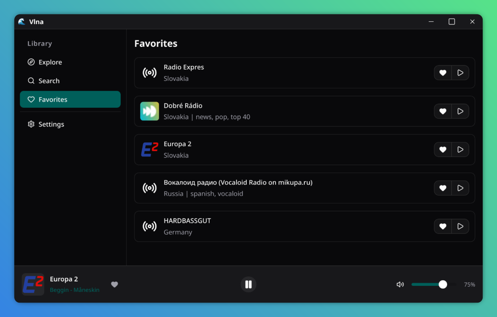

# 🎵 Vlna



[](LICENSE) 

**Vlna** (pronounced _[ˈvl̩na]_, meaning "wave" in Slovak) is a lightweight internet radio player built with Go + Wails 3 + Svelte 5 as my final project for Harvard's CS50x course.

**Video Demo:** TODO

## ✨ Features

- Play internet radio stations from all over the world
- Search and favorite stations
- Real-time display of currently playing song title and artist (ICY metadata)
- Light and dark themes, with persistent theme and language preferences
- Full MPRIS support and media keys support
- Discord Rich Presence integration
- Cross-platform support
- Lightweight desktop app with low resource overhead

<details>
<summary>Easter egg (click to reveal)</summary>

In the bottom player bar, if the currently playing song title or artist contains "Hatsune Miku", it makes her name bold. >:3

</details>

### Tested platforms

- Fedora Workstation 44 (GNOME 50.5) x86_64
- Windows 11 25H2 x86_64

## 📦 Installation (from source)

1. Install [Go](https://go.dev/doc/install)
2. Install a C compiler
3. Install Node.js and npm
4. Install [Wails 3](https://v3.wails.io/quick-start/installation)
5. Clone the repository:

```sh
git clone https://github.com/SladkyCitron/vlna.git
cd vlna
```

6. Build the app:

```sh
wails3 build
```

The built app will be located in the `bin` directory.

## 🛠️ Architecture (because CS50x requires it)

The application is built using [Go](https://go.dev) and the [Wails 3](https://v3.wails.io) framework, with [Svelte 5](https://svelte.dev) + TypeScript + Tailwind CSS + shadcn + Paraglide on the web frontend side.
Wails is a GUI framework for Go that allows the use of web technologies (HTML, CSS, JS) to build desktop applications. It's like Electron but for Go, and it uses the system's webview instead of bundling Chromium making it more lightweight and efficient than Electron.
For the audio, I used my own audio framework, [Resona](https://github.com/SladkyCitron/resona), which uses [Oto](https://github.com/ebitengine/oto) under the hood for audio playback. Resona's built-in MP3 decoder is pure Go but it's limited and doesn't support Layer III streams (which seems to be most internet radios), so I had to integrate minimp3 via cgo instead.

One of the most interesting parts of the project was handling network streams. HTTP network data doesn't always come at a steady rate, it comes at unpredictable bursts, especially on a flaky network connection. Initially, reading directly from `resp.Body` into the ICY + MP3 decoder caused lots of stuttering and freezing on the audio playback. To fix this, I had to implement a background goroutine that reads the network stream into a 512 KB ring buffer with a pre-buffering check. This basically decouples the network reading from audio playback, absorbing flaky network jitter and ensuring smooth playback.
MPRIS support and Discord Rich Presence also deserve a mention. MPRIS support was a bit tricky to implement because I've never worked with D-Bus before, but I managed to figure it out and it works on GNOME (my DE) now. Discord Rich Presence was a little easier to implement, basically what I had to do was first register my app on the Discord Developer Portal, but then I had to vendor and patch an existing Go package because it didn't look for Discord running in Flatpak. After fixing it, it works pretty much flawlessly now.

Building a complete desktop app with Wails and Svelte was... an interesting experience. I'm new to web development but I learned a lot and I think the result is pretty good. :D
I actually originally wanted to learn Wails and Svelte anyways for one of my other projects, [GoTAU](https://github.com/SladkyCitron/gotau), but after trying Wails out, I decided that [Gio](https://gioui.org) would be a better fit for GoTAU, but I used Wails for this project and learned webdev anyways, so there's that. Also screw Rust.

I first did the rough MVP, added some extra features and details, and then I sent the app to one of my friends (outside CS50x) to test it. After a few bugfixes and feedback, I think the app is now in a good state to be properly released.

I did very little AI-assisted coding, I just used GitHub Copilot a little bit to help me out because it's free (via ISIC) and I don't have money for Claude.

### Project structure

- `.github/workflows` - GitHub Actions for building the app for Windows (because my friend uses Windows and I use Fedora)
- `bin` - built app binaries
- `build` - build files and scripts (Dockerfiles, manifests, icons, etc.)
- `frontend` - Svelte 5 + TypeScript frontend
- `service` - Go backend Wails services (for stuff like stations, player, settings, etc.)
  - `config.go` - configuration service (for reading/writing settings)
  - `ipinfo.go` - IP info service (for getting the user's country and city for station filtering)
  - `player.go` - player service (for playing stations)
  - `station.go` - stations service (for searching stations)
  - `version.go` - version service (for getting the app version in the frontend)
- `icy` - ICY metadata parser (for getting currently playing song title and artist)
- `minimp3` - MP3 decoder (from minimp3, a small MP3 decoder written in C)
- `mpris` - MPRIS support (for Linux media keys and media players)
- `discordrichpresence` - Discord Rich Presence support, originally vendored from [discordrichpresence](https://github.com/jacksonthemaster/discordrichpresence) but patched to support Discord running in Flatpak
- `version` - version information

## ⚖️ License

MIT License (see [LICENSE](LICENSE))
